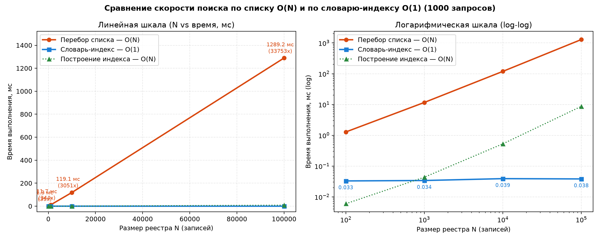

# Лабораторная работа № 7: Моделирование реестра на основе словарей и множеств

[](https://www.python.org/downloads/)
[]()
[]()

> **Дисциплина:** Программирование и прототипирование ИТ-решений  
> **Направление подготовки:** 09.03.03 Прикладная информатика (Бизнес и системная аналитика)  
> **Студент:** Мусин Тимур Булатович  
> **Группа:** БЦШ02-26-02  
> **Вариант:** А (базовая) + Б (исследовательская траектория), **N = 17**  

---

## 1. Описание проекта

Репозиторий содержит реализацию реестра фонда скважин на базе стандартных структур данных Python (`list[dict]`, `dict`, `set`), а также экспериментальное исследование сложности поиска по списку $O(N)$ против поиска по словарю-индексу $O(1)$.

### Ключевые возможности
1. **Валидация и сборка реестра (`main.py`):**
   - `validate_record(record)` проверяет тип контейнера, наличие обязательных ключей, типы (с отсечением `bool` в `is_number`) и допустимые диапазоны значений;
   - `build_registry(raw)` формирует рабочий реестр, отсеивая некорректные записи и дубликаты `id` за $O(1)$ с помощью множества `seen`.
2. **Агрегация по ключу (`aggregate`):** универсальная группировка по любому полю (`field`, `status`, `type`) с расчётом `count`, `sum`, `avg`, `min`, `max` и проверкой инварианта количества записей.
3. **Многокритериальная выборка (`set`):** функции `unique_values()`, `ids_where()`, `ids_in_range()` и комбинирование выборок операциями `&`, `|`, `-`, `^`, `<=`.
4. **Исследовательская часть (`experiments.py`):**
   - проверка нехешируемости `dict` и обходные пути (`tuple(r.items())`, `frozenset(r.items())`);
   - группировки через `Counter` и `defaultdict`, агрегация по паре ключей `(field, status)`;
   - воспроизводимый бенчмарк (`Random(42)`, `time.perf_counter()`, 3 повтора) для $N \in \{100, 1000, 10\,000, 100\,000\}$ с отдельным измерением времени построения индекса.

---

## 2. Структура проекта

```text
lab7_registry/
├── main.py                         # Базовый реестр (Вариант А)
├── experiments.py                  # Исследования и бенчмарк (Вариант Б)
├── exercises.py                    # Проверка и вывод упражнений 1 и 3–6
├── plot_generator.py               # Генератор графика сложности (упражнение 7)
├── plot_complexity.png             # График сравнения O(N) и O(1)
├── benchmark_results.json          # Результаты замеров скорости
├── README.md                       # Документация репозитория
├── REPORT.md                       # Полный отчёт по лабораторной работе
└── Отчет_ЛР7_Мусин_ТБ_вар17.docx   # Чистовой отчёт в формате DOCX
```

---

## 3. Быстрый старт

Скрипты `main.py`, `experiments.py` и `exercises.py` используют только стандартную библиотеку Python (3.10+):

```bash
# Вариант А: валидация, агрегация и выборки на множествах
python3 main.py

# Вариант Б: хешируемость, Counter/defaultdict и бенчмарк индекса
python3 experiments.py

# Демонстрация обязательных упражнений 1 и 3–6
python3 exercises.py
```

Для перегенерации графика (требуется `matplotlib`):

```bash
python3 plot_generator.py
```

---

## 4. Результаты замеров скорости (1000 запросов, среднее из 3 запусков)

| N | Перебор списка, мс | Словарь-индекс, мс | Ускорение | Построение индекса, мс |
| ---: | ---: | ---: | ---: | ---: |
| 100 | 1.28 | 0.033 | 39× | 0.006 |
| 1 000 | 11.66 | 0.034 | 344× | 0.043 |
| 10 000 | 119.09 | 0.039 | 3 051× | 0.527 |
| 100 000 | 1289.15 | 0.038 | 33 753× | 8.713 |



Полный разбор результатов, ручная трассировка агрегации, ответы на 7 обязательных упражнений и 10 контрольных вопросов приведены в [REPORT.md](REPORT.md) и [Отчет_ЛР7_Мусин_ТБ_вар17.docx](Отчет_ЛР7_Мусин_ТБ_вар17.docx).
