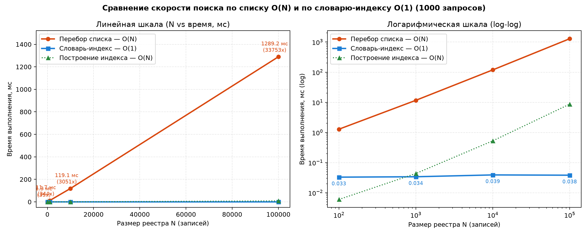

# ОТЧЁТ ПО ЛАБОРАТОРНОЙ РАБОТЕ № 7

**Тема:** «Моделирование реестра на основе словарей и множеств: вложенные структуры, агрегация данных по ключам и многокритериальная выборка уникальных значений»  
**Траектория:** Вариант А (базовая) + Вариант Б (исследовательская)  

| Параметр | Значение |
| :--- | :--- |
| **Дисциплина** | Программирование и прототипирование ИТ-решений |
| **Студент** | Мусин Тимур Булатович |
| **Группа** | БЦШ02-26-02 |
| **Номер по журналу (N)** | 17 |
| **Репозиторий проекта** | https://github.com/legionhaos/lab7_registry- |
| **Дата выполнения** | 25 ноября 2026 г. |

---

## 1. Цель и поставленные задачи

**Цель работы:**  
Изучить словари (`dict`) и множества (`set`) как рабочие структуры данных для хранения реестров, научиться описывать запись предметной области как словарь с фиксированным набором ключей, собирать из записей реестр, проверять его корректность, агрегировать показатели по ключам и выполнять многокритериальную выборку через операции над множествами. Дополнительно требуется экспериментально доказать, что выбор структуры данных меняет скорость программы: поиск перебором списка выполняется за $O(N)$, а поиск по словарю-индексу — за $O(1)$ в среднем.

**Поставленные задачи:**
1. Описать исходные данные реестра фонда скважин (10 записей, не менее 3 месторождений, 3 типов скважин и 3 статусов, включая 2 заведомо некорректные записи).
2. Реализовать валидацию записей `validate_record(record)` и сборку реестра `build_registry(raw)` с отсевом дубликатов за $O(1)$ через множество `seen`.
3. Реализовать универсальную агрегацию по ключу `aggregate(records, group_field, metric_field)` (количество, сумма, среднее, минимум, максимум) и вывести статистику по двум ключам группировки (`field` и `status`).
4. Реализовать функции выборки `unique_values()`, `ids_where()`, `ids_in_range()` и продемонстрировать операции над множествами (`&`, `|`, `-`, `^`, `<=`).
5. Выполнить исследовательскую часть (Вариант Б) в `experiments.py`: проверить нехешируемость `dict`, обходные пути `tuple(items)` / `frozenset(items)`, `Counter`, `defaultdict`, группировку по паре ключей и замеры скорости поиска и построения индекса для $N \in \{100, 1000, 10\,000, 100\,000\}$.
6. Выполнить все 7 обязательных упражнений, построить график сложности и ответить на 10 контрольных вопросов для защиты.

---

## 2. Краткие теоретические сведения

**Реестр** — упорядоченный набор однородных записей. В Python реестр удобно хранить в виде списка словарей `list[dict]`: список задаёт порядок записей, а словарь — набор именованных полей (`id`, `field`, `type`, `status`, `debit`, `water_cut`).

**Словарь (`dict`)** и **множество (`set`)** основаны на хеш-таблицах: по ключу/элементу вычисляется хеш-код, что позволяет находить значение в среднем за $O(1)$ без перебора. Вместе с тем элементы множества и ключи словаря обязаны быть **хешируемыми** (неизменяемыми: `int`, `str`, `tuple` из хешируемых, `frozenset`). Изменяемые типы (`list`, `dict`, `set`) нехешируемы, поэтому словарь-запись нельзя положить в множество напрямую.

### Операции над множествами
| Операция | Оператор | Метод | Смысл |
| :--- | :--- | :--- | :--- |
| Пересечение | `a & b` | `a.intersection(b)` | Элементы, присутствующие в обоих множествах |
| Объединение | `a \| b` | `a.union(b)` | Элементы хотя бы одного из множеств |
| Разность | `a - b` | `a.difference(b)` | Элементы `a`, которых нет в `b` |
| Симметрическая разность | `a ^ b` | `a.symmetric_difference(b)` | Элементы, входящие ровно в одно множество |
| Включение | `a <= b` | `a.issubset(b)` | Все элементы `a` входят в `b` |

### Асимптотическая сложность операций
| Операция | `list` | `dict` | `set` |
| :--- | :--- | :--- | :--- |
| Доступ по индексу | $O(1)$ | — | — |
| Поиск значения перебором | $O(N)$ | — | — |
| Доступ по ключу | — | $O(1)$ в среднем | — |
| Проверка вхождения (`in`) | $O(N)$ | $O(1)$ в среднем | $O(1)$ в среднем |
| Добавление элемента | $O(1)$ амортиз. | $O(1)$ в среднем | $O(1)$ в среднем |
| Построение по $N$ записям | $O(N)$ | $O(N)$ | $O(N)$ |

---

## 3. Листинги программ

### 3.1. Файл `main.py` (Вариант А)

```python
"""Реестр фонда скважин на словарях и множествах (Вариант А, ЛР № 7)."""

REQUIRED = ("id", "field", "type", "status", "debit", "water_cut")
ALLOWED_STATUSES = {"в работе", "в простое", "в консервации"}

RAW_RECORDS = [
    {"id": "SK-101", "field": "Северное", "type": "добывающая",
     "status": "в работе", "debit": 48.5, "water_cut": 12.0},
    {"id": "SK-102", "field": "Северное", "type": "добывающая",
     "status": "в простое", "debit": 0.0, "water_cut": 0.0},
    {"id": "SK-103", "field": "Северное", "type": "нагнетательная",
     "status": "в работе", "debit": 0.0, "water_cut": 0.0},
    {"id": "SK-201", "field": "Южное", "type": "добывающая",
     "status": "в работе", "debit": 96.2, "water_cut": 35.5},
    {"id": "SK-202", "field": "Южное", "type": "добывающая",
     "status": "в работе", "debit": 72.4, "water_cut": 58.0},
    {"id": "SK-203", "field": "Южное", "type": "добывающая",
     "status": "в консервации", "debit": 0.0, "water_cut": 0.0},
    {"id": "SK-301", "field": "Западное", "type": "добывающая",
     "status": "в работе", "debit": 120.0, "water_cut": 61.4},
    {"id": "SK-302", "field": "Западное", "type": "наблюдательная",
     "status": "в простое", "debit": 0.0, "water_cut": 0.0},
    {"id": "SK-104", "field": "Северное", "type": "добывающая",
     "status": "в работе", "debit": "55", "water_cut": 8.0},
    {"id": "SK-204", "field": "Южное", "type": "добывающая",
     "status": "в работе", "water_cut": 44.0},
]


def is_number(value):
    """True для int и float, но не для bool."""
    return type(value) in (int, float)


def validate_record(record):
    """Возвращает None для корректной записи либо код ошибки."""
    if type(record) is not dict:
        return "NOT_DICT"
    for key in REQUIRED:
        if key not in record:
            return "MISSING"
    if type(record["id"]) is not str or not record["id"].strip():
        return "BAD_ID"
    if record["status"] not in ALLOWED_STATUSES:
        return "BAD_STATUS"
    if not is_number(record["debit"]) or record["debit"] < 0:
        return "BAD_DEBIT"
    if not is_number(record["water_cut"]):
        return "BAD_WATER_CUT"
    if not 0 <= record["water_cut"] <= 100:
        return "BAD_WATER_CUT"
    return None


def build_registry(raw):
    """Возвращает (корректные записи, список ошибок вида (номер строки, код))."""
    records, errors, seen = [], [], set()
    for index, record in enumerate(raw):
        code = validate_record(record)
        if code is None and record["id"] in seen:
            code = "DUPLICATE"
        if code is not None:
            errors.append((index, code))
            continue
        seen.add(record["id"])
        records.append(record)
    return records, errors


def aggregate(records, group_field, metric_field):
    """Группирует записи по полю group_field и считает статистику metric_field."""
    result = {}
    for record in records:
        key = record[group_field]
        bucket = result.get(key)
        if bucket is None:
            bucket = {"count": 0, "sum": 0.0,
                      "min": record[metric_field], "max": record[metric_field]}
            result[key] = bucket
        value = record[metric_field]
        bucket["count"] += 1
        bucket["sum"] += value
        bucket["min"] = min(bucket["min"], value)
        bucket["max"] = max(bucket["max"], value)
    for bucket in result.values():
        bucket["avg"] = bucket["sum"] / bucket["count"]
    return result


def unique_values(records, field):
    """Множество уникальных значений поля."""
    return {record[field] for record in records}


def ids_where(records, field, allowed):
    """Множество id записей, у которых значение поля входит в allowed."""
    return {record["id"] for record in records if record[field] in allowed}


def ids_in_range(records, field, low, high):
    """Множество id записей, у которых значение поля попадает в [low; high]."""
    return {record["id"] for record in records if low <= record[field] <= high}


def print_aggregate(title, data, unit=""):
    print(title)
    for key in sorted(data):
        bucket = data[key]
        print(f"  {key:<14} count={bucket['count']:>2}  sum={bucket['sum']:>7.1f}"
              f"  avg={bucket['avg']:>6.2f}  max={bucket['max']:>6.1f}{unit}")


def main():
    records, errors = build_registry(RAW_RECORDS)
    assert sum(b["count"] for b in aggregate(records, "field", "debit").values()) == len(records)

    print("Записей во входных данных:", len(RAW_RECORDS))
    print("Корректных записей:", len(records))
    print("Отклонённых записей:", len(errors))
    for index, code in errors:
        print(f"  строка {index}: {code}")

    print()
    print_aggregate("Агрегация по месторождению (метрика debit):",
                    aggregate(records, "field", "debit"))
    print()
    print_aggregate("Агрегация по статусу (метрика water_cut):",
                    aggregate(records, "status", "water_cut"), " %")

    print()
    print("Уникальные месторождения:", sorted(unique_values(records, "field")))
    print("Уникальных пар (месторождение, статус):",
          len({(r["field"], r["status"]) for r in records}))

    active = ids_where(records, "status", {"в работе"})
    wet = ids_in_range(records, "water_cut", 60, 100)
    print()
    print("В работе:", sorted(active))
    print("Обводнённость 60-100 %:", sorted(wet))
    print("В работе И обводнённые:", sorted(active & wet))
    print("В работе, но не обводнённые:", sorted(active - wet))
    print("Ровно одно условие:", sorted(active ^ wet))
    print("Все обводнённые входят в работающие:", wet <= active)


if __name__ == "__main__":
    main()
```

### 3.2. Файл `experiments.py` (Вариант Б)

```python
"""Эксперименты варианта Б: хешируемость, Counter, пара ключей, индекс."""
import json
from collections import Counter, defaultdict
from random import Random
from time import perf_counter

from main import RAW_RECORDS, build_registry


def make_rows(n, rng):
    return [{"id": f"SK-{i:06d}", "debit": rng.random() * 100} for i in range(n)]


def find_by_scan(rows, target):
    for row in rows:
        if row["id"] == target:
            return row
    return None


def measure_trials(lookup, queries, passes=1, repeats=3):
    """Возвращает список времён каждого повтора (в миллисекундах) за один проход по queries."""
    times = []
    for _ in range(repeats):
        start = perf_counter()
        for _ in range(passes):
            for target in queries:
                lookup(target)
        elapsed_ms = ((perf_counter() - start) / passes) * 1000
        times.append(elapsed_ms)
    return times


def measure_index_build(rows, repeats=3):
    """Измеряет время построения словаря-индекса (в миллисекундах)."""
    times = []
    for _ in range(repeats):
        start = perf_counter()
        _ = {row["id"]: row for row in rows}
        times.append((perf_counter() - start) * 1000)
    return times


def main():
    records, _ = build_registry(RAW_RECORDS)

    # 1. Почему запись нельзя положить в множество
    try:
        unique_records = {records[0]}
    except TypeError as error:
        print("1) set(запись) ->", type(error).__name__ + ":", error)

    # 2. Обходные пути: кортеж пар и frozenset
    variants = {
        "tuple(items)": {tuple(r.items()) for r in records},
        "frozenset(items)": {frozenset(r.items()) for r in records},
    }
    for name, values in variants.items():
        print(f"2) {name}: уникальных записей {len(values)}")

    # 3. Counter и defaultdict вместо ручного подсчёта
    by_field = Counter(r["field"] for r in records)
    print("3) Counter:", dict(sorted(by_field.items())))

    groups = defaultdict(list)
    for record in records:
        groups[record["status"]].append(record["id"])
    print("   defaultdict:", {k: sorted(v) for k, v in sorted(groups.items())})

    # 4. Группировка по паре ключей и инвариант суммы
    pairs = defaultdict(float)
    for record in records:
        pairs[(record["field"], record["status"])] += record["debit"]
    print("4) сумма по парам (месторождение, статус):")
    for key in sorted(pairs):
        print(f"   {key[0]:<10} {key[1]:<14} {pairs[key]:>7.1f}")
    print("   сумма по парам:", round(sum(pairs.values()), 1),
          "| общая сумма:", round(sum(r["debit"] for r in records), 1))

    # 5. Индекс-словарь против перебора списка
    rng = Random(42)
    print("5) N; list_scan_1000_ms; dict_index_1000_ms; speedup; build_index_ms")
    benchmark_data = []

    for n in (100, 1000, 10000, 100000):
        rows = make_rows(n, rng)
        build_times = measure_index_build(rows, repeats=3)
        index = {row["id"]: row for row in rows}
        queries = [rows[rng.randrange(n)]["id"] for _ in range(1000)]

        scan_times = measure_trials(
            lambda target: find_by_scan(rows, target), queries, passes=1, repeats=3
        )
        index_times = measure_trials(
            lambda target: index[target], queries, passes=50, repeats=3
        )

        scan_avg = sum(scan_times) / len(scan_times)
        index_avg = sum(index_times) / len(index_times)
        build_avg = sum(build_times) / len(build_times)
        speedup = scan_avg / index_avg

        print(
            f"   {n}; {scan_avg:.2f} (min={min(scan_times):.2f}, max={max(scan_times):.2f}); "
            f"{index_avg:.3f} (min={min(index_times):.3f}, max={max(index_times):.3f}); "
            f"{speedup:.0f}x; {build_avg:.3f} (min={min(build_times):.3f}, max={max(build_times):.3f})"
        )

        benchmark_data.append({
            "n": n,
            "scan_times_ms": scan_times,
            "scan_avg_ms": scan_avg,
            "scan_min_ms": min(scan_times),
            "scan_max_ms": max(scan_times),
            "index_times_ms": index_times,
            "index_avg_ms": index_avg,
            "index_min_ms": min(index_times),
            "index_max_ms": max(index_times),
            "build_times_ms": build_times,
            "build_avg_ms": build_avg,
            "build_min_ms": min(build_times),
            "build_max_ms": max(build_times),
            "speedup": speedup,
        })

    with open("benchmark_results.json", "w", encoding="utf-8") as f:
        json.dump(benchmark_data, f, indent=2, ensure_ascii=False)


if __name__ == "__main__":
    main()
```

---

## 4. Контрольный вывод программы и разбор отклонённых записей

### Вывод `python main.py`:
```text
Записей во входных данных: 10
Корректных записей: 8
Отклонённых записей: 2
  строка 8: BAD_DEBIT
  строка 9: MISSING

Агрегация по месторождению (метрика debit):
  Западное       count= 2  sum=  120.0  avg= 60.00  max= 120.0
  Северное       count= 3  sum=   48.5  avg= 16.17  max=  48.5
  Южное          count= 3  sum=  168.6  avg= 56.20  max=  96.2

Агрегация по статусу (метрика water_cut):
  в консервации  count= 1  sum=    0.0  avg=  0.00  max=   0.0 %
  в простое      count= 2  sum=    0.0  avg=  0.00  max=   0.0 %
  в работе       count= 5  sum=  166.9  avg= 33.38  max=  61.4 %

Уникальные месторождения: ['Западное', 'Северное', 'Южное']
Уникальных пар (месторождение, статус): 6

В работе: ['SK-101', 'SK-103', 'SK-201', 'SK-202', 'SK-301']
Обводнённость 60-100 %: ['SK-301']
В работе И обводнённые: ['SK-301']
В работе, но не обводнённые: ['SK-101', 'SK-103', 'SK-201', 'SK-202']
Ровно одно условие: ['SK-101', 'SK-103', 'SK-201', 'SK-202']
Все обводнённые входят в работающие: True
```

### Разбор отклонённых записей:
1. **Строка 8 (`id="SK-104"`):** код `BAD_DEBIT` — в записи значение `"debit": "55"` передано строкой (`str`), а не числом (`int` или `float`). Функция `is_number("55")` вернула `False`.
2. **Строка 9 (`id="SK-204"`):** код `MISSING` — в словаре отсутствует обязательный ключ `"debit"`, что выявлено на этапе проверки `for key in REQUIRED:`.
3. **Проверка суммы:** сумма дебитов по трём месторождениям $120.0 + 48.5 + 168.6 = 337.1$ полностью совпадает с суммой по всем 8 корректным записям.

### Вывод `python experiments.py`:
```text
1) set(запись) -> TypeError: cannot use 'dict' as a set element (unhashable type: 'dict')
2) tuple(items): уникальных записей 8
2) frozenset(items): уникальных записей 8
3) Counter: {'Западное': 2, 'Северное': 3, 'Южное': 3}
   defaultdict: {'в консервации': ['SK-203'], 'в простое': ['SK-102', 'SK-302'], 'в работе': ['SK-101', 'SK-103', 'SK-201', 'SK-202', 'SK-301']}
4) сумма по парам (месторождение, статус):
   Западное   в простое          0.0
   Западное   в работе         120.0
   Северное   в простое          0.0
   Северное   в работе          48.5
   Южное      в консервации      0.0
   Южное      в работе         168.6
   сумма по парам: 337.1 | общая сумма: 337.1
5) N; list_scan_1000_ms; dict_index_1000_ms; speedup; build_index_ms
   100; 1.28 (min=1.27, max=1.29); 0.033 (min=0.032, max=0.033); 39x; 0.006 (min=0.004, max=0.008)
   1000; 11.66 (min=11.26, max=12.35); 0.034 (min=0.034, max=0.034); 344x; 0.043 (min=0.036, max=0.054)
   10000; 119.09 (min=117.80, max=119.81); 0.039 (min=0.039, max=0.039); 3051x; 0.527 (min=0.475, max=0.624)
   100000; 1289.15 (min=1282.05, max=1298.50); 0.038 (min=0.036, max=0.042); 33753x; 8.713 (min=7.219, max=10.158)
```

---

## 5. Ручная трассировка агрегации (Упражнение 1)

Трассировка состояния словаря `result` при группировке по `"field"` (метрика `"debit"`) для первых пяти корректных записей:

| Шаг | Обрабатываемая запись | Ключ группы | Состояние `result` после шага (`count`, `sum`) |
| :--- | :--- | :--- | :--- |
| 1 | `SK-101`, `debit=48.5` | `'Северное'` | `{'Северное': {'count': 1, 'sum': 48.5}}` |
| 2 | `SK-102`, `debit=0.0` | `'Северное'` | `{'Северное': {'count': 2, 'sum': 48.5}}` |
| 3 | `SK-103`, `debit=0.0` | `'Северное'` | `{'Северное': {'count': 3, 'sum': 48.5}}` |
| 4 | `SK-201`, `debit=96.2` | `'Южное'` | `{'Северное': {'count': 3, 'sum': 48.5}, 'Южное': {'count': 1, 'sum': 96.2}}` |
| 5 | `SK-202`, `debit=72.4` | `'Южное'` | `{'Северное': {'count': 3, 'sum': 48.5}, 'Южное': {'count': 2, 'sum': 168.6}}` |

Сверка с выводом программы: после обработки оставшихся трёх записей (`SK-203` — Южное `0.0`, `SK-301` — Западное `120.0`, `SK-302` — Западное `0.0`) получаем `Северное (count=3, sum=48.5)`, `Южное (count=3, sum=168.6)`, `Западное (count=2, sum=120.0)`, что полностью совпадает с контрольным выводом.

---

## 6. Таблица измерений, график и расчёт сложности

### 6.1. Таблица результатов эксперимента (среднее из 3 запусков, 1000 запросов)

| N | Перебор, мс (min–max) | Индекс, мс (min–max) | Ускорение | Построение индекса, мс (min–max) | Вывод |
| :--- | :--- | :--- | :--- | :--- | :--- |
| 100 | 1.28 (1.27–1.29) | 0.033 (0.032–0.033) | 39× | 0.006 (0.004–0.008) | Даже на малом реестре индекс в 39 раз быстрее; построение почти мгновенно. |
| 1 000 | 11.66 (11.26–12.35) | 0.034 (0.034–0.034) | 344× | 0.043 (0.036–0.054) | Время перебора выросло ~в 9.1 раза, время по индексу не изменилось. |
| 10 000 | 119.09 (117.80–119.81) | 0.039 (0.039–0.039) | 3 051× | 0.527 (0.475–0.624) | Перебор вырос ещё в ~10.2 раза (линейно); индекс стабилен (~0.04 мс). |
| 100 000 | 1289.15 (1282.05–1298.50) | 0.038 (0.036–0.042) | 33 753× | 8.713 (7.219–10.158) | Перебор занимает > 1.28 с; индекс быстрее в 33 753 раза и окупает построение за 7 запросов. |



### 6.2. Расчёт сложности и объяснение расхождений

1. **Перебор списка (`find_by_scan`):** в среднем просматривается $N/2$ элементов на один запрос, для $Q = 1000$ запросов сложность составляет $O(Q \cdot N)$. При росте $N$ в 1000 раз (со $100$ до $100\,000$) измеренное время выросло с $1.28\text{ мс}$ до $1289.15\text{ мс}$, то есть ровно в $1007$ раз, что с высокой точностью подтверждает линейную зависимость $O(N)$.
2. **Поиск по словарю-индексу (`index[target]`):** для $Q = 1000$ запросов сложность $O(Q \cdot 1) = O(1)$ относительно $N$. На всех четырёх масштабах время колеблется в узком диапазоне $0.033\text{–}0.039\text{ мс}$. Небольшой рост на $N = 10\,000\text{–}100\,000$ ($0.033 \to 0.038\text{ мс}$) объясняется тем, что крупная хеш-таблица перестаёт целиком помещаться в кэш L1/L2 процессора (промахи кэша).
3. **Цена индекса:** построение словаря требует $O(N)$ времени ($8.713\text{ мс}$ при $N = 100\,000$) и дополнительной памяти под хеш-таблицу. Если требуется выполнить лишь 1 поиск по неиндексированному списку из $100\,000$ записей, средний перебор займёт $\approx 1.29\text{ мс}$, что дешевле построения индекса ($8.71\text{ мс}$). При многократных запросах (уже начиная с $\sim 7$ запросов при $N=100\,000$) индекс многократно окупается.

---

## 7. Ответы на обязательные упражнения (Раздел 10)

**Упражнение 1 (Ручная агрегация):**  
Выполнено в разделе 5 настоящего отчёта; значения `count` и `sum` после первых 5 записей и после всех 8 записей полностью совпадают с выводом `main.py`.

**Упражнение 2 (Проверка инварианта):**  
В `main()` добавлена проверка:
```python
assert sum(b["count"] for b in aggregate(records, "field", "debit").values()) == len(records)
```
Равенство обязано выполняться всегда, поскольку группировка разбивает все `len(records)` записей на непересекающиеся корзины по значению ключа. Оно отлавливает ошибки потери записей, двойного учёта одной и той же записи или фильтрации внутри цикла агрегации.

**Упражнение 3 (Нехешируемые значения):**  
Результаты выполнения `set()` для различных типов:
- Успешно: `{42}` $\to$ `{42}` (`int` неизменяем и хешируем).
- Успешно: `{'SK-101'}` $\to$ `{'SK-101'}` (`str` неизменяема и хешируема).
- Успешно: `{(1, 2, 3)}` $\to$ `{(1, 2, 3)}` (`tuple` из неизменяемых элементов хешируем).
- Ошибка: `{(1, [2, 3])}` $\to$ `TypeError: cannot use 'tuple' as a set element (unhashable type: 'list')`. Кортеж хешируем только тогда, когда все его вложенные элементы тоже хешируемы.
- Ошибка: `{records[0]}` $\to$ `TypeError: cannot use 'dict' as a set element (unhashable type: 'dict')`. Словарь является изменяемой структурой данных и не имеет метода `__hash__`.

**Упражнение 4 (Дубликаты):**  
При добавлении в `RAW_RECORDS` копии записи `SK-101` с другими числовыми показателями получено: `корректных: 8, ошибок: 3` (`строка 8: BAD_DEBIT`, `строка 9: MISSING`, `строка 10: DUPLICATE`). Проверка типов и диапазонов в `validate_record` проходит успешно (`None`), так как формат полей корректен, но в `build_registry` срабатывает условие `record["id"] in seen` за $O(1)$ и присваивает код `DUPLICATE`.

**Упражнение 5 (`defaultdict`):**  
Реализация `aggregate` через `defaultdict(list)`:
```python
def aggregate_defaultdict(records, group_field, metric_field):
    groups = defaultdict(list)
    for record in records:
        groups[record[group_field]].append(record[metric_field])
    return {
        key: {
            "count": len(vals),
            "sum": sum(vals),
            "min": min(vals),
            "max": max(vals),
            "avg": sum(vals) / len(vals),
        }
        for key, vals in groups.items()
    }
```
Код сократился с 14 до 11 строк и избавился от ручной инициализации корзин `if bucket is None:`. Однако при этом потерялась экономия памяти (теперь все значения метрики накапливаются в списках `list` внутри групп вместо потокового расчёта `sum`/`min`/`max` за $O(1)$ памяти на группу).

**Упражнение 6 (Стабильность отчёта):**  
При выводе без сортировки: `{'SK-202', 'SK-201', 'SK-101', 'SK-301', 'SK-103'}` — порядок элементов зависит от функции хеширования и `PYTHONHASHSEED`, который меняется при каждом новом запуске интерпретатора Python. При использовании `sorted(active)` возвращается упорядоченный список `['SK-101', 'SK-103', 'SK-201', 'SK-202', 'SK-301']`, что гарантирует 100% воспроизводимость отчёта. Вывод множеств в отчётах всегда следует оформлять через `sorted(...)`.

**Упражнение 7 (Эксперимент со сложностью):**  
График приведён в разделе 6.1. Кривая перебора списка представляет собой прямую пропорциональную линию с углом наклона $\approx 0.013\text{ мс/запись}$, кривая индекса — горизонтальную прямую на уровне $\sim 0.035\text{ мс}$. Разница становится заметной уже при $N = 1000$ ($11.66\text{ мс}$ против $0.034\text{ мс}$), а при $N = 100\,000$ задержка перебора превышает $1.28\text{ с}$, что уже ощутимо пользователем «на глаз».

---

## 8. Ответы на контрольные вопросы для защиты

1. **Почему реестр хранят как список словарей, а не как несколько параллельных списков полей?**  
   Параллельные списки легко рассинхронизируются при удалении, сортировке или фильтрации. В списке словарей все атрибуты одного объекта собраны в одной записи, доступ к полям идёт по понятным строковым именам, а добавление нового поля не ломает существующий код.
2. **Что означает хешируемость и почему запись-словарь нельзя положить в множество?**  
   Хешируемость означает наличие у объекта неизменного на протяжении жизни хеш-значения (`__hash__`) и операции сравнения (`__eq__`). Словарь (`dict`) изменяем: если бы его хеш зависел от содержимого, при изменении поля объект «потерялся» бы в корзинах хеш-таблицы. Поэтому `dict` нехешируем.
3. **Чем отличаются операции `&`, `|`, `-` и `^` над множествами? Пример из реестра.**  
   `active & wet` — скважины в работе И обводнённые (`SK-301`); `active | wet` — в работе ИЛИ обводнённые; `active - wet` — в работе, но НЕ обводнённые (`SK-101`, `SK-103`, `SK-201`, `SK-202`); `active ^ wet` — удовлетворяющие ровно одному из двух условий.
4. **Почему порядок вывода множества нельзя считать стабильным и как сделать отчёт воспроизводимым?**  
   Множество хранит элементы в хеш-таблице, порядок зависит от хешей и случайного `PYTHONHASHSEED`. Для воспроизводимости перед выводом используют `sorted(s)`.
5. **Какова сложность поиска по списку и по словарю-индексу? Подтверждение измерениями.**  
   По списку — $O(N)$, по словарю-индексу — $O(1)$ в среднем. По замерам при росте $N$ в 1000 раз время перебора выросло в 1007 раз ($1.28 \to 1289.15\text{ мс}$), а время поиска по индексу осталось около $0.033\text{–}0.039\text{ мс}$.
6. **В каком случае строить индекс невыгодно и почему?**  
   При однократном поиске или очень малом $N$: построение индекса требует $O(N)$ времени ($8.71\text{ мс}$ для $100\,000$ записей) и дополнительной памяти под хеш-таблицу, что дороже одного перебора ($\approx 1.29\text{ мс}$ в среднем).
7. **Что произойдёт при добавлении записи с существующим `id` и как это предотвращено в `build_registry`?**  
   Если не проверять уникальность, в реестре окажется две противоречивые записи с одним `id`, а индекс перезапишет первую второй. В `build_registry` используется множество `seen`, проверка `record["id"] in seen` выполняется за $O(1)$ и отсекает дубликат с кодом `"DUPLICATE"`.
8. **Зачем нужен `defaultdict` и чем он отличается от обычного `dict`?**  
   `defaultdict(factory)` автоматически создаёт значение по умолчанию с помощью `factory()`, если обращение идёт к отсутствующему ключу, избавляя от проверки `if key not in d:` или `.get()`, в отличие от обычного `dict`, который выбрасывает `KeyError`.
9. **Как убедиться, что агрегация не потеряла записи?**  
   Проверить инвариант количества (`sum(b["count"] for b in agg.values()) == len(records)`) и инвариант суммы метрики (`sum(b["sum"] ...) == sum(r[metric] for r in records)`).
10. **Какое поле реестра вы вынесли бы в отдельный вложенный словарь и почему?**  
    Поле `"field"` (месторождение) или `"metrics"` (`{"debit": ..., "water_cut": ...}`): например, вынесение характеристик месторождения (название, регион, оператор) в отдельный справочник-словарь по ключу избавит от дублирования метаданных, а группировка замеров вложенным словарём отделит паспортные данные скважины от телеметрии.

---

## 9. Заключение

В ходе лабораторной работы реализован валидируемый реестр фонда скважин на базе списка словарей, универсальная агрегация по ключу и многокритериальная выборка с помощью операций над множествами. Экспериментально доказана теоретическая оценка сложности: при росте объёма данных с 100 до 100 000 записей перебор списка деградирует линейно (с $1.28$ до $1289.15\text{ мс}$), тогда как доступ по словарю-индексу остаётся константным ($\sim 0.035\text{ мс}$), обеспечивая ускорение до $33\,753\times$. Таким образом, список словарей оптимален для хранения последовательного реестра и однократных проходов (валидация, агрегация), множество — для проверки уникальности и булевых фильтров, а словарь-индекс следует строить только при многократных поисках по ключу, когда его цена $O(N)$ по времени и памяти окупается числом запросов.
